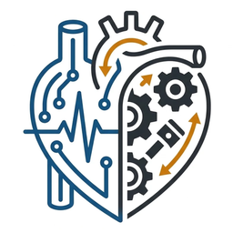

<!-- Home-page header: the logo beside the title. The page has no `title`, so Quarto draws no title
block; `pagetitle` sets the browser-tab title and `description` the search-engine summary. -->
:::: {.home-header}
[{width="128" height="128"}]{.home-logo}

::: {.home-heading}
# Open EP Mapping Lab {.title .unnumbered .unlisted}

::: {.subtitle}
How electroanatomic mapping systems work, from membrane current to color map
:::
:::
::::



::: {.hero-actions}
[Read the pilot module](modules/m03-electrograms.qmd){.btn .btn-primary}
[See all 55 modules](course-map.qmd){.btn .btn-outline-primary}
:::

::: {.callout-warning appearance="simple"}
Education only. Nothing here is for diagnosis, treatment or any clinical decision.
Read the [disclaimer](disclaimer.qmd) before relying on any content.
:::

Open EP Mapping Lab (**openepengineering.org**, Open EP Engineering) is a free, open course for
engineers joining EP device companies, clinical mapping specialists, EP fellows and researchers.
It follows the signal the whole way: how a mapping system finds the catheter, records and filters
electrograms, and turns them into activation and voltage maps.

## Latest from the blog {#latest-from-the-blog}

::: {#latest-posts}
:::

[All posts →](blog/index.qmd){.epml-all-posts}

## How each module works

- Derivations you can check. Every equation has a test in code.
- Live figures you can change, each labeled as exact, simulation, approximate model or
  schematic, with its assumptions listed underneath.
- A runnable lab in Python, with GNU Octave versions for the math foundations.
- A cheat sheet, practice questions and a self-check, plus a public [errata](errata.qmd) log.

## Status

All 55 modules, in eight parts, have a draft. Each module is written in six stages and reviewed by
a person after each one. None has been reviewed yet, so none is released, and every clinical
section is still pending review by an EP physician. The pilot module,
[m03 · Unipolar, bipolar and omnipolar electrograms](modules/m03-electrograms.qmd), shows the full
format. The [course map](course-map.qmd) lists every module, its status and its planned release.

## Built on

- [OpenEP](https://github.com/openep) for mapping data formats and analysis
- [openCARP](https://www.opencarp.org/) for cardiac simulation
- [PhysioNet](https://physionet.org/) and [EDGAR](https://edgar.sci.utah.edu/) for public recordings

The course format is inspired by [OpenUltrasoundLab](https://openultrasoundlab.org). Open EP Mapping Lab is an
independent educational project and is not affiliated with or endorsed by the [OpenEP](https://openep.io/) project.

## License

Text and figures: CC BY 4.0. Code: MIT. Datasets keep their original licenses.
